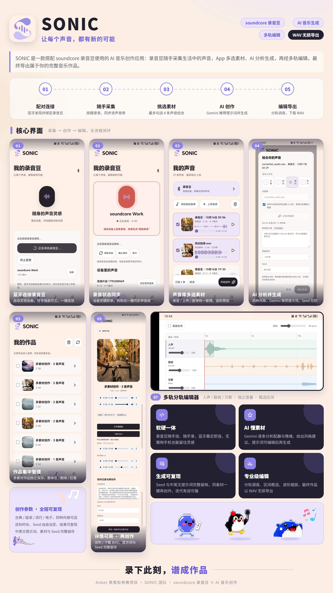
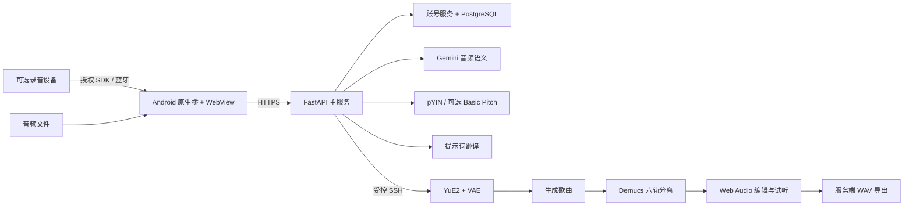

<p align="center"></p>

# SONIC

**Capture Life. Grow Music. 把生活的声音，种成一首歌。**

SONIC 是一个从生活录音和哼唱出发的 Android 音乐创作项目：采集声音、理解素材、编辑创作提示，再生成音乐并进行六轨编辑。

项目由哈尔滨工业大学「嘿嘿嘿客」团队在 Anker 黑客松背景下共同开发。这是整理后的项目展示与团队外围代码快照，不包含厂商 SDK、私有凭据、模型权重或真实用户数据库。团队分工见 [Credits](CREDITS.md)。

## Demo

[观看演示视频（约 47 秒）](docs/media/demo.mp4)



截图和视频来自团队提供的 App 演示，不代表量化音质评测。仓库不分发带旧服务器连接凭据的赛事 APK。

## 功能

- **声音采集**：Android 音频导入；通过可选的录音豆桥同步录音和重点标记。
- **组合创作**：最多选择 4 条素材，哼唱可选；支持古典、摇滚、流行、电子四种方向。
- **先推荐，再确认**：Gemini 分析音频，展示可修改的中文推荐提示词。
- **旋律参考**：pYIN 提取指定哼唱的音高事件，转换为可编辑 ABC；另有 Basic Pitch 转录适配。
- **云端生成**：最终描述译成英文后，将文字和可选 ABC、seed 交给 YuE2。
- **来源可追溯**：作品保存原声引用、中文/英文提示词和 seed，可用相同来源再创作。
- **六轨编辑**：Demucs 分离人声、鼓、贝斯、钢琴、吉他及其他；提供音量、片段静音、复制、移动、局部变调、撤销和 WAV 导出。
- **个人账号**：注册、登录、修改密码、退出及可撤销会话；素材、任务、作品和媒体按账号校验归属。

## 技术架构



| 模块 | 职责 | 技术 |
| --- | --- | --- |
| Android | 设备桥、文件选择、会话、下载 | Java / Kotlin / WebView |
| 创作与编辑界面 | 声音库、提示词、作品、波形与即时试听 | HTML / CSS / JavaScript / Web Audio |
| 主服务 | 上传、分析适配、任务、访问控制 | Python / FastAPI / httpx / Paramiko |
| 账号服务 | 用户、会话、项目、资源归属 | SQLAlchemy / PostgreSQL / Alembic / Argon2 |
| 音频分析 | 基频、音符事件、ABC | librosa / pYIN / pretty-midi |
| GPU 服务 | 音乐生成、分轨、导出 | YuE2 / VAE / Demucs / Pedalboard |

模型运行在独立服务器，手机不需要安装大模型。Gemini 负责声音理解，音符由音高算法提取；二者不混作同一能力。

## 仓库结构

```text
sonic/
├── android/              # 原生壳与团队编写的设备外围桥
├── backend/              # 创作 API、权限、音频适配
│   ├── mobile/           # 手机创作界面
│   ├── live/             # 六轨编辑界面
│   ├── web/              # 本地技术验证入口
│   ├── config/           # 无密钥的配置示例
│   └── tests/            # 独立的主服务测试
├── business/             # PostgreSQL 账号与项目服务
├── gpu-audio/            # 团队六轨服务及页面
├── docs/                 # 安装、架构、数据边界与演示
└── scripts/              # 依赖准备与公开前检查
```

## 从哪里开始

先运行本地后端测试，不需要真实录音豆、模型 Key 或 GPU：

```bash
python -m venv .venv
# 激活虚拟环境：Windows 为 .venv\Scripts\activate，Linux/macOS 为 source .venv/bin/activate
python -m pip install -r backend/requirements.txt
python -m pytest backend/tests -c pytest.ini
```

本地技术预览：

```bash
python scripts/prepare_icons.py
python -m uvicorn app:app --app-dir backend --host 127.0.0.1 --port 8770
```

打开 `http://127.0.0.1:8770/`。上传声音或载入测试旋律，可使用本地音符合成做最小流程验证。**本地音符合成不是 YuE2 生成**；真正的 AI 分析、翻译、歌曲生成和六轨处理需要按 [安装说明](docs/SETUP.md) 配置对应服务。

手机 `/mobile/` 的推荐流程依赖模型服务；个人账号依赖 `business/` 与 PostgreSQL；设备功能依赖自行取得授权的 SDK。完整复现条件与独立启动方式均写在 [SETUP.md](docs/SETUP.md)。

## 已验证与限制

该项目是可演示的研究原型，不是通用音乐生成质量保证：

- ABC 是旋律参考，不承诺逐音符复刻任意哼唱。
- 生活素材通过语义提示影响创作，不保证原采样或指定音效出现在歌曲中。
- 120 秒等时长选项是提示，生成结果不保证精确等长。
- 分轨可能串音；音量显示/交互测试不等同于音质或混音振幅验收。
- GPU 任务依赖网络和远程环境；服务重启后的处理中任务自动恢复尚未实现。
- 没有 iOS、离线大模型、短信/邮箱找回密码或自动数据到期清理。
- 默认本地开发模式不启用账号强制隔离，不应直接对公网开放。公网必须启用 App 门禁与用户隔离，详见 [安全说明](SECURITY.md)。

整理前的集成版本留有主后端、数据库、双账号访问控制和原生网络验证记录；硬件真机与模型音乐效果的验证范围不同。此仓库的当前验证命令与结果见 [测试说明](docs/TESTING.md)。

## 贡献与依赖

这是团队项目，可作为参与者的个人作品展示；作者分工和队友贡献保留在 [CREDITS.md](CREDITS.md)。模型和基础库为外部依赖，不将其声称为团队自研模型。

本仓库未自动选择 MIT/Apache 等全仓库再授权协议。各贡献者代码与品牌/设计的权利仍归其相应权利人；第三方组件遵循各自许可证。详见 [依赖与权利说明](THIRD_PARTY.md)。
